# Biblioteca IPF

Trabajo Práctico N° 4 — App integradora del Taller Complementario React Native II
(Tecnicatura Superior en Desarrollo de Software Multiplataforma · Instituto Politécnico Formosa).

App para que los alumnos consulten el catálogo de la biblioteca, reserven libros y reciban un
recordatorio de devolución, y para que el personal entregue los libros respetando el orden de las
reservas. Las respuestas de análisis (Partes B a E) están en [`RESPUESTAS.md`](./RESPUESTAS.md).

## Versiones

| Paquete | Versión |
|---|---|
| **Expo SDK** | **58** (`expo` 58.0.26) |
| expo-router | 58.0.32 |
| React Native | 0.88.1 |
| React | 19.3.0 (React Compiler activo) |
| expo-camera | 58.0.14 |
| expo-notifications | 58.1.9 |

El proyecto se creó con `npx create-expo-app@latest` y todos los paquetes se instalaron con
`npx expo install`. No se usa `expo-permissions`, `expo-location` ni `expo-image-picker`.

## Cómo ejecutar

```bash
npm install
npx expo start
```

Escaneá el código QR con **Expo Go** (Android o iOS) en un teléfono conectado a la misma red.

| Comando | Para qué |
|---|---|
| `npx expo start` | Servidor de desarrollo |
| `npx expo lint` | Lint (ESLint con `eslint-config-expo`) |
| `npx tsc --noEmit` | Chequeo de tipos |
| `npm test` | Tests con `jest-expo` |

**Credenciales del personal** (fijas en `src/constants/biblioteca.ts`): usuario `biblioteca`, clave
`ipf2026`.

**Libros para probar el escáner:** tienen su ISBN real los primeros nueve libros de
`src/data/libros.ts` y estos tres, agregados para escanear ejemplares propios:

| Libro | Edición | ISBN |
|---|---|---|
| *La metamorfosis* (Franz Kafka) | El Ateneo, 2025 | `9789500216388` |
| *Prótesis Dental I: guía de prácticas de laboratorio* | Universitat de València, 2024 | `9788411184069` |
| *Wigetta y los gusanos guasones* (Vegetta777 y Willyrex) | Temas de Hoy, 2016 | `9788499985534` |

Cada edición tiene su propio ISBN: si tu ejemplar es de otra editorial, cambiá el ISBN en
`src/data/libros.ts` por el de la contratapa (13 dígitos, sin guiones).

## Árbol de rutas (`src/app`) y navegador de cada `_layout`

```
src/app/
├── _layout.tsx               Stack raíz (renderiza NavegadorRaiz). Provider del Context,
│                             ThemeProvider y anchor "(tabs)". Stack.Protected para login/mostrador.
├── (tabs)/
│   ├── _layout.tsx           Tabs (import 'expo-router/js-tabs', SDK 58). Anchor "(catalogo)".
│   ├── (catalogo)/
│   │   ├── _layout.tsx       Stack propio de la tab Catálogo. Anchor "index".
│   │   ├── index.tsx         /                 Catálogo (+ "Vistos recientemente", Buscar, Escanear)
│   │   ├── escanear.tsx      /escanear         Escáner (cámara, 4 estados) + ISBN a mano
│   │   └── libro/
│   │       └── [isbn].tsx    /libro/[isbn]     Detalle validado
│   └── reservas.tsx          /reservas         Tab "Mis reservas"
├── buscar.tsx                /buscar?q=        Stack raíz
├── reservar/
│   └── [isbn].tsx            /reservar/[isbn]  Stack raíz, presentation: "modal"
├── permisos/
│   └── [recurso].tsx         /permisos/[recurso]  presentation: "modal" (camara | notificaciones)
├── login.tsx                 /login            Modal, solo existe sin sesión
├── mostrador.tsx             /mostrador        Stack raíz, solo existe con sesión
├── reserva.tsx               /reserva          <Redirect href="/reservas" />
└── +not-found.tsx            cualquier otra    404 con la URL inexistente
```

El Stack raíz está en `src/components/NavegadorRaiz.tsx`: necesita leer la sesión del Context para
`Stack.Protected`, así que el layout raíz lo renderiza dentro del Provider (un componente por archivo).
`/escanear` está dentro del Stack del Catálogo para poder ir al detalle con `router.replace` sin duplicar
las pestañas (ver `RESPUESTAS.md`, C2).

## Estructura de `src`

| Carpeta | Contenido |
|---|---|
| `app/` | Solo rutas y layouts |
| `components/` | Componentes (uno por archivo) |
| `hooks/` | `useLibros`, `useLibro`, `useBusqueda`, `usePermiso`, `useBiblioteca`, tema |
| `lib/` | API simulada, reductor de la biblioteca, catálogo, notificaciones, permisos, persistencia |
| `context/` | `BibliotecaContext` (préstamos, listas de espera, recientes, sesión y avisos) |
| `estructuras/` | `Pila` y `Cola` con `#items`, `tamanio` y `aArray()` (+ tests) |
| `data/` | Libros y listas de espera iniciales |
| `types/` | `Libro` (tal cual la consigna) y tipos del dominio |
| `constants/` | `tema.ts` (colores, tamaños, espaciados), textos de permisos, constantes |

## Bloque `plugins` de `app.json` (comentado)

```jsonc
"plugins": [
  // Expo Router: rutas basadas en archivos dentro de src/app.
  "expo-router",
  // Pantalla de carga: queda visible hasta recuperar los datos guardados (la app no se ve vacía).
  ["expo-splash-screen", {
    "backgroundColor": "#1E3A8A",
    "image": "./assets/images/splash-icon.png",
    "imageWidth": 76
  }],
  // Cámara: agrega CAMERA (Android) y NSCameraUsageDescription (iOS) con nuestro texto.
  ["expo-camera", {
    // Texto de propósito con el molde "Usamos tu [dato] para [beneficio concreto]".
    "cameraPermission": "Usamos tu cámara para leer el código de barras del libro y abrir su ficha sin escribir el ISBN.",
    // Mínimo privilegio: no grabamos video con sonido.
    "microphonePermission": false,   // sin NSMicrophoneUsageDescription en iOS
    "recordAudioAndroid": false,     // sin RECORD_AUDIO en Android
    "barcodeScannerEnabled": true    // necesitamos leer EAN-13
  }],
  // Notificaciones locales: recordatorio de devolución y aviso de entrega.
  ["expo-notifications", {
    "color": "#1E3A8A",                 // color del ícono de la notificación en Android
    "enableRemoteNotifications": false  // solo locales: sin entitlement aps-environment en iOS
  }]
]
```

## Permisos

| Recurso | Módulo | Cuándo se pide | Alternativa si se niega |
|---|---|---|---|
| Cámara | `expo-camera` (`useCameraPermissions` dentro de `usePermiso`) | Al tocar “Usar la cámara” en `/escanear`, después de la pantalla previa `/permisos/camara` | Escribir el ISBN a mano en la misma pantalla. Si está bloqueado, botón “Abrir Ajustes”. |
| Notificaciones | `expo-notifications` | **Solo** al activar “Recordarme” en un préstamo, después de la pantalla previa `/permisos/notificaciones`. En Android se crea antes el canal `prestamos`. | Los avisos aparecen dentro de la app, arriba de “Mis reservas”. |

La app no pide ningún otro permiso. Ningún permiso denegado bloquea la app.

### `blockedPermissions` (Android)

```json
"blockedPermissions": [
  "android.permission.RECORD_AUDIO",
  "android.permission.ACCESS_FINE_LOCATION",
  "android.permission.ACCESS_COARSE_LOCATION",
  "android.permission.READ_MEDIA_IMAGES",
  "android.permission.READ_MEDIA_VIDEO",
  "android.permission.READ_MEDIA_AUDIO",
  "android.permission.READ_EXTERNAL_STORAGE",
  "android.permission.WRITE_EXTERNAL_STORAGE"
]
```

Justificación (mínimo privilegio): la app solo usa la cámara para leer códigos de barras y
notificaciones locales.

- `RECORD_AUDIO`: `expo-camera` lo agrega por defecto para grabar video con sonido; acá no se graba
  nada. Se desactiva en el plugin y además se bloquea por si otra dependencia lo agrega.
- Ubicación (`ACCESS_FINE/COARSE_LOCATION`): la app no necesita saber dónde está la persona.
- Fotos, videos, audio y almacenamiento (`READ_MEDIA_*`, `READ/WRITE_EXTERNAL_STORAGE`): la app no lee
  ni guarda archivos del teléfono (los datos propios se guardan con AsyncStorage, que no requiere
  permisos).

Bloquearlos hace que Expo agregue `tools:node="remove"` en el `AndroidManifest.xml`: aunque una
librería los declare, no llegan al binario. Esto se verifica en una development build, no en Expo Go.

## Deep links de prueba

Con *scheme* propio (development build) o en Expo Go con `exp://IP:8081/--/…`:

| Link | Resultado esperado |
|---|---|
| `bibliotecaipf://libro/9780132350884` | Detalle de *Clean Code*, con el Catálogo debajo |
| `bibliotecaipf://libro/123` | Mensaje “Este enlace no corresponde a un libro del catálogo” + “Ir al catálogo” |
| `bibliotecaipf://buscar?q=borges` | Buscador con “borges” y las pestañas debajo |
| `bibliotecaipf://mostrador` | Sin sesión: Catálogo (redirección de `Stack.Protected` al anchor) |
| `bibliotecaipf://reserva` | Redirige a Mis reservas |
| `bibliotecaipf://escanear` | Escáner (con la cámara bloqueada: “Abrir Ajustes” + ISBN a mano) |
| `bibliotecaipf://cualquier/cosa` | 404 con la URL |

Ejemplo en Expo Go (Android): `adb shell am start -a android.intent.action.VIEW -d "exp://192.168.0.10:8081/--/libro/9780132350884"`.

## Desafíos opcionales implementados

- **Persistencia** con `@react-native-async-storage/async-storage`: préstamos (con el identificador de
  su notificación), listas de espera, recientes y avisos. La pantalla de carga se mantiene hasta
  terminar de leerlos, así que la app nunca aparece vacía. Al iniciar se reconcilian los
  identificadores con las notificaciones que el sistema todavía tiene programadas.
- **Pruebas** con `jest-expo`: 12 tests de `Pila` y `Cola` (incluido desencolar una cola vacía), tests de
  navegación con `expo-router/testing-library` y tests de la condición de carrera del buscador.
- **Debounce** de 300 ms en el buscador, con limpieza del temporizador.
- **Modo oscuro** con `useColorScheme` y los colores de `src/constants/tema.ts`.

## Salida de lint, TypeScript y tests

```text
> npx expo lint
(sin errores ni advertencias)  exit 0

> npx tsc --noEmit
(sin errores)  exit 0

> npm test
Test Suites: 4 passed, 4 total
Tests:       24 passed, 24 total
```

## Capturas

Carpeta [`capturas/`](./capturas). Se tomaron con la app real corriendo en su versión web (React Native
Web, `npx expo export --platform web`) en un navegador Chromium sin interfaz, con tamaño de celular
(390 × 844):

### Catálogo

| Cargando | Con error | Con datos |
|:---:|:---:|:---:|
| 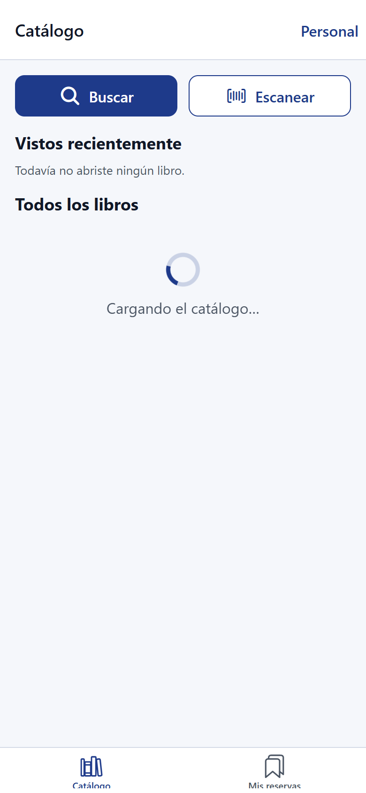 | 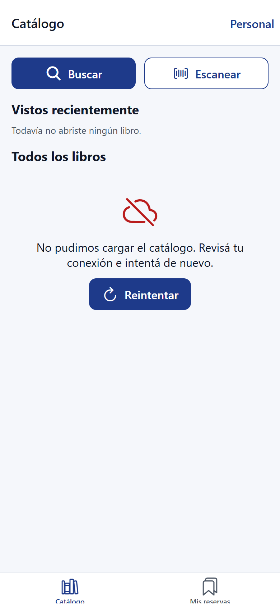 | 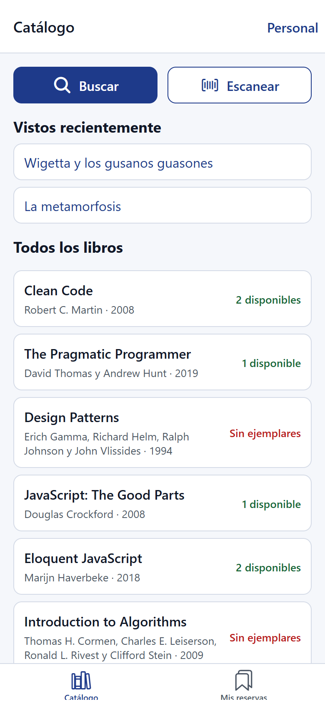 |

### Buscador y detalle

| Buscador (`q=borges`) | Detalle | Detalle inexistente (`/libro/123`) |
|:---:|:---:|:---:|
| 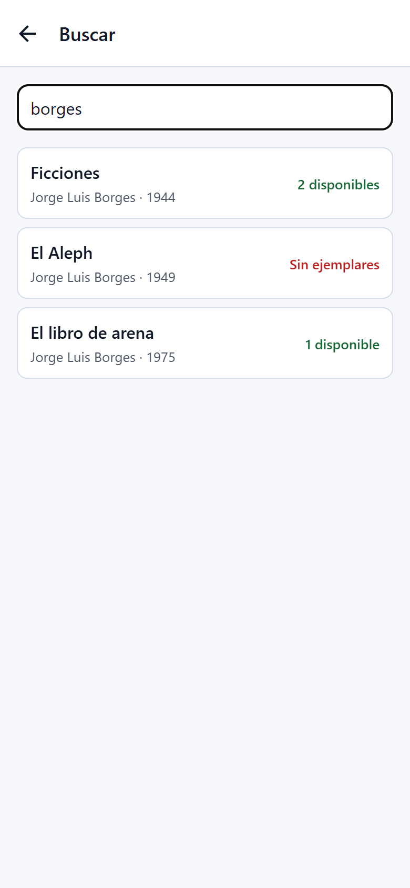 | 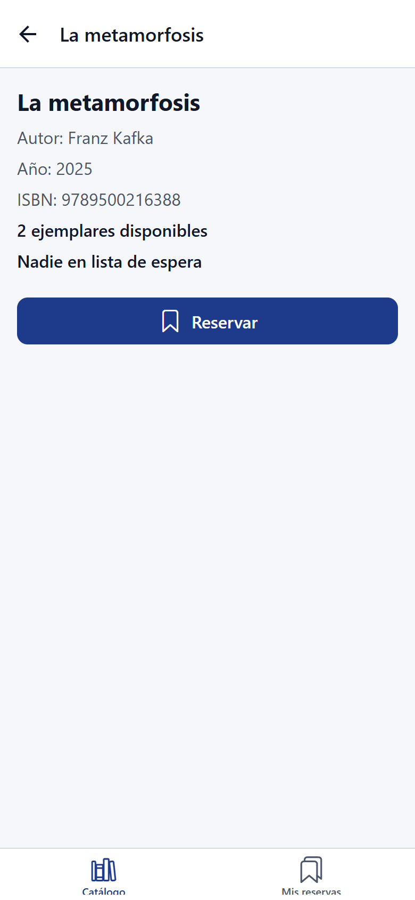 | 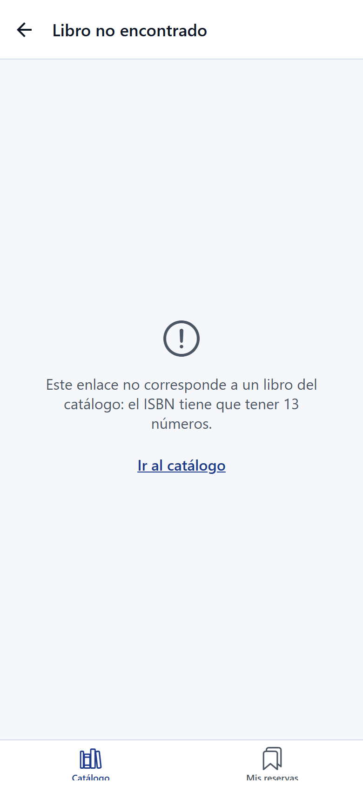 |

### Reservas

| Con ejemplares | Sin ejemplares | Mis reservas |
|:---:|:---:|:---:|
| 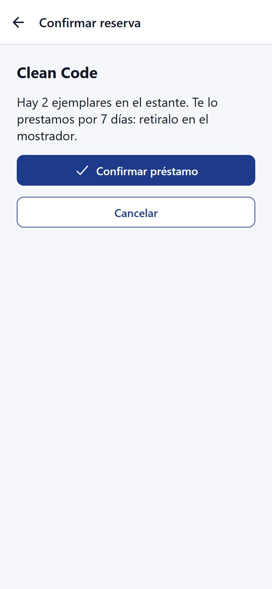 | 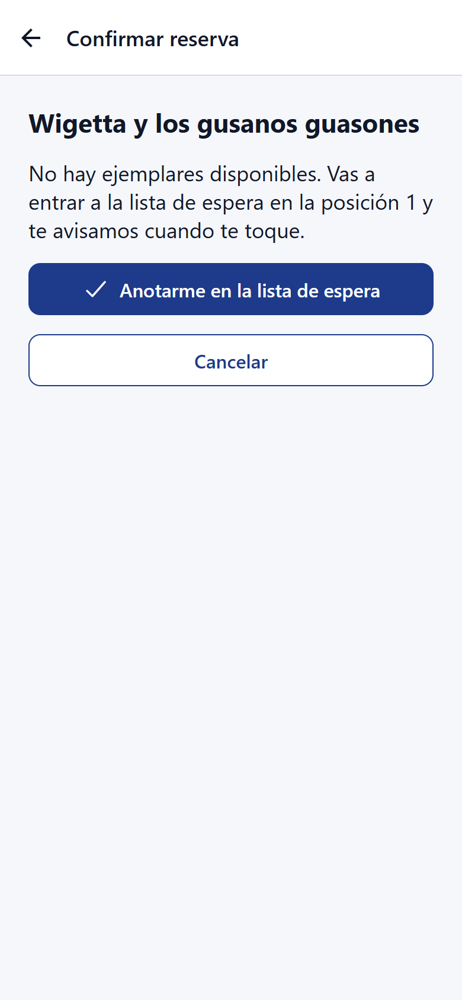 | 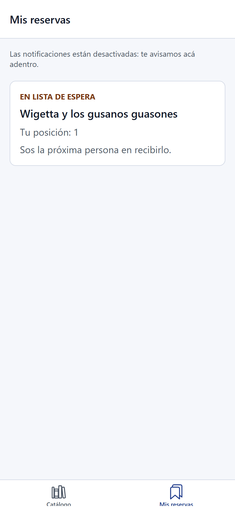 |

### Escáner: los cuatro estados

| Cargando | Preguntable | Concedido | Bloqueado |
|:---:|:---:|:---:|:---:|
| 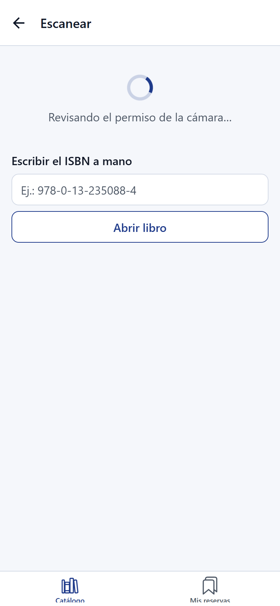 | 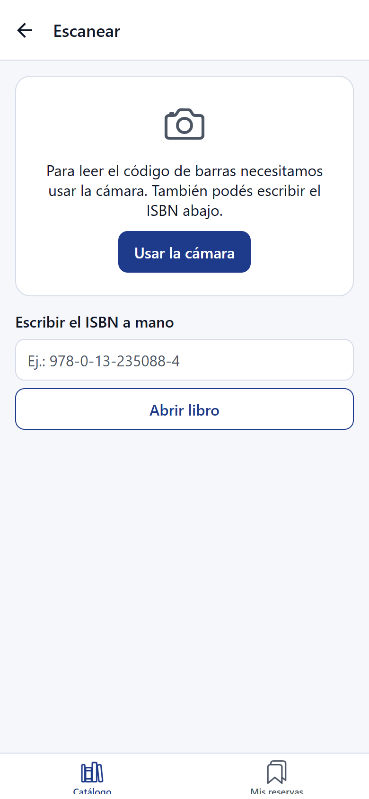 | 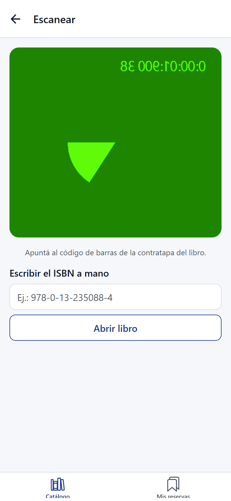 | 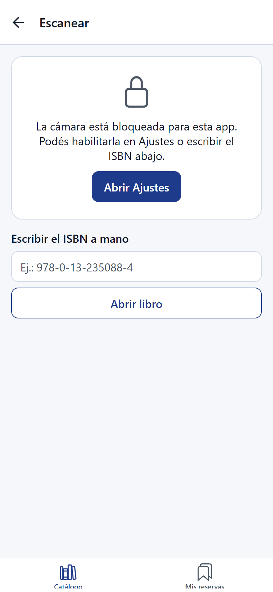 |

| Pantalla previa al permiso |
|:---:|
| 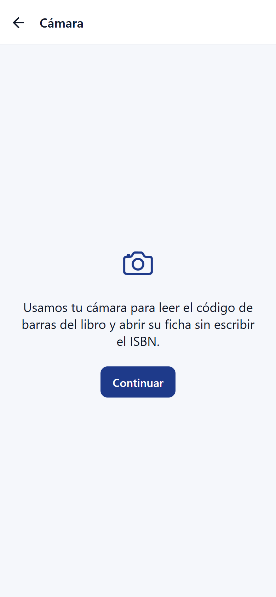 |

### Personal de biblioteca

| Login | Mostrador antes | Mostrador después de “Entregar al siguiente” |
|:---:|:---:|:---:|
| 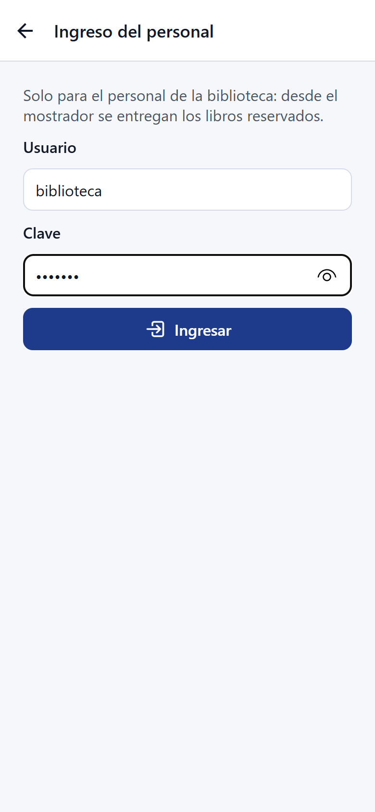 | 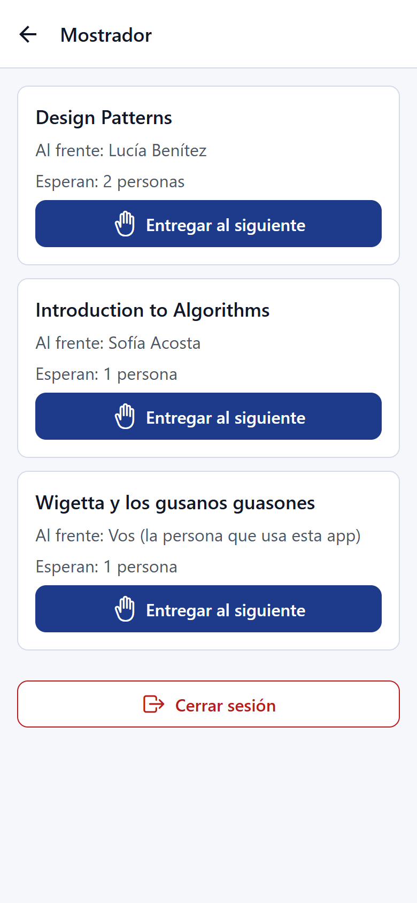 | 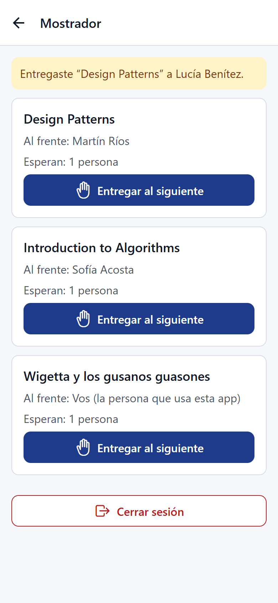 |

### Avisos y 404

| Aviso dentro de la app (sin permiso de notificaciones) | Página 404 |
|:---:|:---:|
| 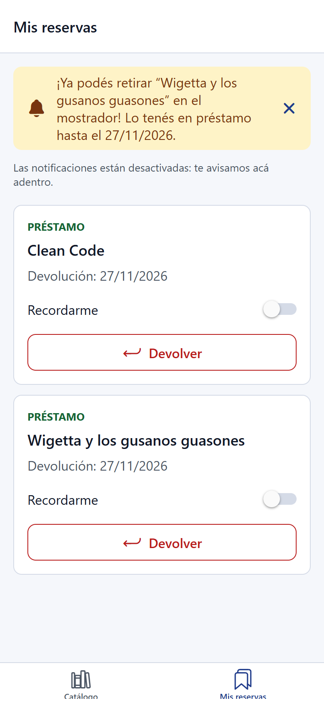 | 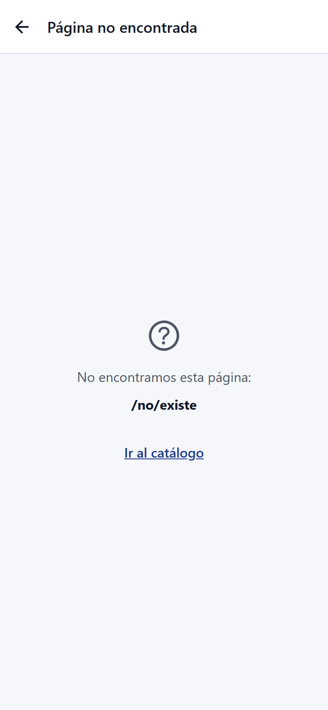 |

Aclaraciones sobre cómo se forzaron algunos estados en el navegador:

- **Escáner cargando**: se dejó pendiente la consulta del permiso para poder fotografiar ese estado,
  que en el teléfono dura un instante.
- **Escáner concedido**: la imagen verde es la cámara de prueba del navegador, no una cámara real.
- **Escáner bloqueado**: en web, `expo-camera` siempre responde `canAskAgain: true`, así que se simuló la
  respuesta que da Android después de dos negativas (`denied` y `canAskAgain: false`).
- **Notificación recibida**: falta. `expo-notifications` no muestra notificaciones locales en web; esa
  captura hay que tomarla en el teléfono con Expo Go (activar “Recordarme” y esperar 15 segundos).
